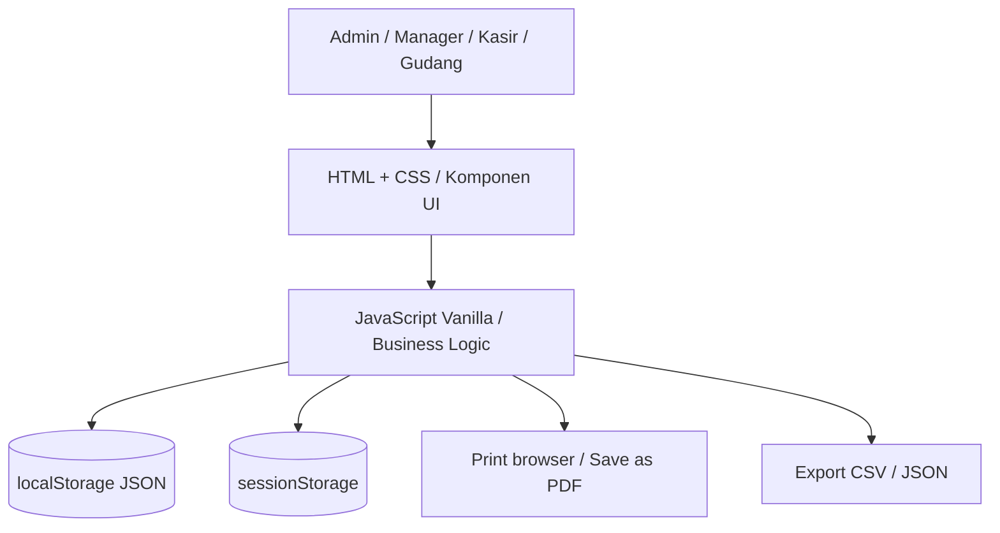
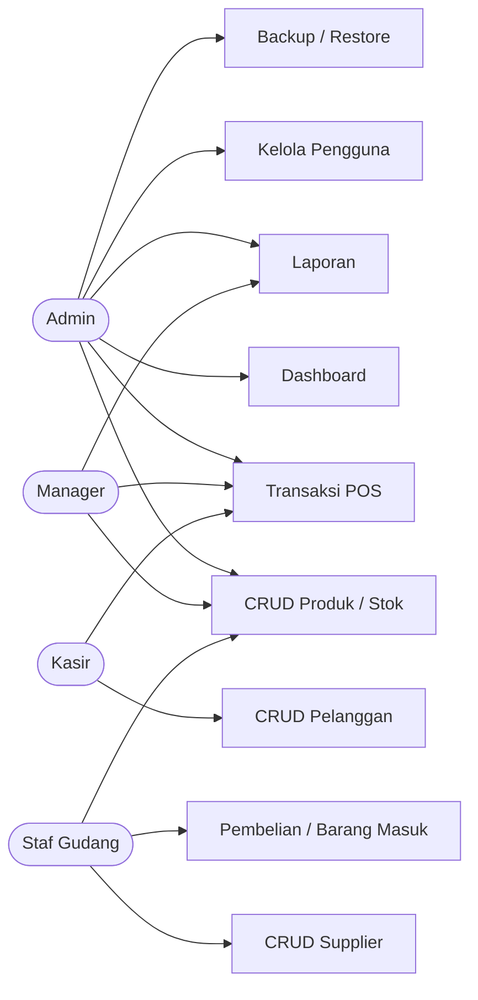
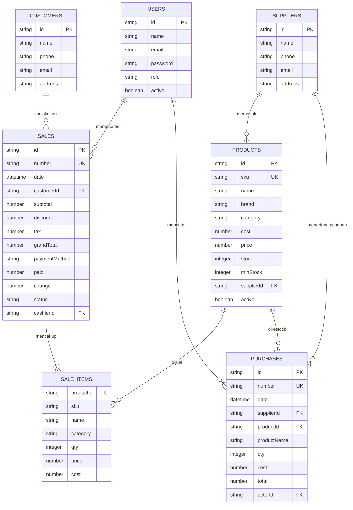
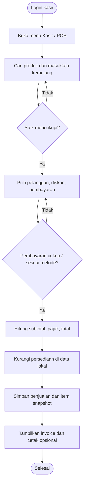
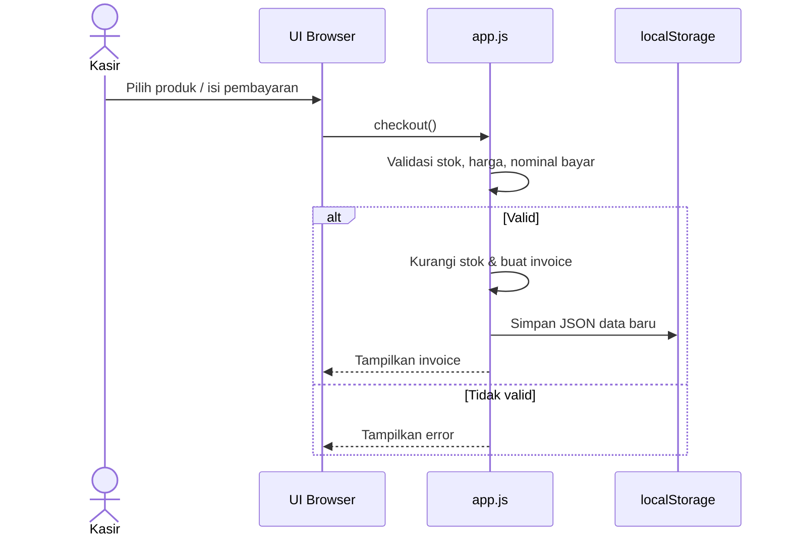

# PERANCANGAN SISTEM — NEXORA TECH RETAIL OS

Dokumen ini menjelaskan arsitektur prototipe (HTML + CSS + JS) dan **ERD konseptual**, bukan tabel SQL yang benar-benar terpasang. Seluruh data saat ini berada pada satu dokumen JSON di `localStorage`.

## 1. Arsitektur browser

## 2. Use Case

## 3. ERD konseptual

Catatan: `SALE_ITEMS` benar-benar disimpan sebagai array `items[]` di tiap `sales` object, bukan tabel terpisah. PK/FK di sini adalah relasi logis; tidak ada `FOREIGN KEY` SQL di browser.

## 4. Activity diagram penjualan

## 5. Sequence diagram penjualan

## 6. Hak akses di UI (simulasi)

| Menu | Admin | Manager | Kasir | Gudang |
|---|:---:|:---:|:---:|:---:|
| Dashboard | ✓ | ✓ | ✓ | ✓ |
| Produk & Stok | ✓ | ✓ | — | ✓ |
| Kasir / POS | ✓ | ✓ | ✓ | — |
| Riwayat Penjualan | ✓ | ✓ | ✓ | — |
| Batalkan Penjualan | ✓ | ✓ | — | — |
| Pelanggan | ✓ | ✓ | ✓ | — |
| Supplier | ✓ | ✓ | — | ✓ |
| Pembelian & Restock | ✓ | ✓ | — | ✓ |
| Laporan | ✓ | ✓ | — | — |
| Kelola Pengguna | ✓ | — | — | — |
| Pengaturan Profil Toko | ✓ | ✓ | — | — |
| Backup/Restore/Reset | ✓ | — | — | — |
| Etalase Produk | ✓ | ✓ | ✓ | ✓ |

**PERINGATAN KEAMANAN:** Role di atas adalah pemeriksaan tampilan & aksi dalam JS; tidak bisa menjadi akses kontrol tepercaya tanpa server.

## 7. Aturan laporan kategori

Invoice bisa memuat beberapa kategori. Saat memilih satu kategori di laporan, nilai invoice diproyeksikan sebagai berikut:

- `subtotal_kategori = Σ(qty × harga_jual)` untuk item kategori tersebut.
- `rasio_kategori = subtotal_kategori / subtotal_semua_kategori`.
- `diskon_kategori = pembulatan(diskon_invoice × rasio_kategori)`.
- `pajak_kategori = pembulatan(pajak_invoice × rasio_kategori)`.
- `kontribusi_omzet_kategori = subtotal_kategori - diskon_kategori + pajak_kategori`.

Nilai proyeksi merupakan estimasi kontribusi per kategori; jumlah setelah pembulatan bisa berselisih beberapa rupiah dari nilai invoice utuh.
